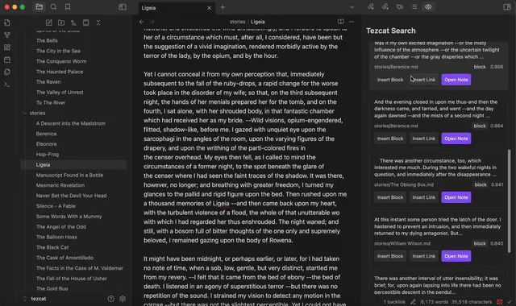

# `tezcat`

Tezcat is a [remembrance agent](https://www.bradleyrhodes.com/Papers/remembrance.html) for Obsidian. As you write, it shows passages from elsewhere in your vault that relate to what's around your cursor, so you can link, quote or revisit them without searching.

Keyword search with a [bm25](https://en.wikipedia.org/wiki/Okapi_BM25) index is enabled by default and requires no network connection. Semantic and hybrid search are optional and use embedding models that you choose, either running on your local machine or running via a cloud embedding provider.

## Using `tezcat`

Start by opening the panel from the eye icon in the ribbon or use **Tezcat: Open panel** in the command palette (Cmd+P). Search results across fragments from other vault files appear in the panel and update as you edit, move your cursor, and move around the vault. The panel opens each time Obsidian starts; turn off **Open panel on startup** in settings to keep it closed once you close it.

For each related block, you can take the following actions:

- **Insert text** to put the result fragment at your cursor.
- **Insert link** to insert an Obsidian link to the result fragment's note at your cursor.
- **Open** to open the note, highlight the passage, and view it in context.
- **Clicking** on the note to copy its text to your clipboard.

Fragments from your current note are never shown in its own results and the quantity of search fragments that come from the same different note is limited.

## Search in `tezcat`

Search options:
- **Keyword search (default).**: Passages are indexed and ranked with bm25 a common and performant index for text keyword search against the words around your cursor. This is the default search setting and requires no additional software.
- **Semantic search (optional).**: Semantic embedding vectors are computed from fragments of notes in your vault, using local or remote inference, and stored in a vector index. The text around your cursor is embedded using the same model and compared against the vector index in a ranked similarity search.
- **Hybrid search (optional).**: The text around your cursor is simulataneously used in both keyword and semantic search and the significance values are mixed together using [reciprocal rank fusion (RRF)](https://www.elastic.co/docs/reference/elasticsearch/rest-apis/reciprocal-rank-fusion).

Semantic and hybrid search are enabled in the settings by using the **Semantic search* slider.
- When the slider is set to 0, only keyword search is performed
- When the slider is set to 1, only semantic search is performed
- When the slider is set to any value in-between, that value is used to determine the relative importance of keyword vs. semantic search in the final search ranking.

If the embedding inference provider is unavailable, `tezcat` falls back to keyword results and notifies you of the issue in the status bar. Note that any use of semantic search (slider above 0) will increase the latency of search results.

There are two toggleable filters that keep repeated material out of results:

- **Filter detected boilerplate** hides passages repeated across five or more notes, such as templated headers and bylines, and shows any other repeated passage once.
- **Filter common phrasing** hides passages made only of words that are common across your vault (for vaults of 20 or more notes).

## Setting up semantic search

Tezcat works with any server that offers an OpenAI-compatible embeddings API. In settings, set the **Endpoint URL** and pick a **Model**; the model list comes from the server.

| Server | Endpoint URL | Notes |
|---|---|---|
| [Ollama](https://ollama.com/download) (default) | `http://localhost:11434/v1` | Runs locally. Settings offer to download recommended models (bge-m3, nomic-embed-text, qwen3-embedding:0.6b), or run `ollama pull <model>`. |
| [LM Studio](https://lmstudio.ai) | `http://localhost:1234/v1` | Runs locally. Download an embedding model in LM Studio and start its server. |
| llama.cpp server | `http://localhost:8080/v1` | Runs locally. Start it with an embedding model and `--embeddings`. |
| [OpenRouter](https://openrouter.ai) | `https://openrouter.ai/api/v1` | Hosted; needs an API key and is paid per use. |
| [OpenAI](https://platform.openai.com) | `https://api.openai.com/v1` | Hosted; needs an API key and is paid per use. |

- **API keys** are stored in Obsidian's secret storage, not in the plugin's settings file. Local servers don't need one.
- **Instruction prefixes** that some models expect (for example nomic-embed-text's `search_query:` / `search_document:`) are filled in automatically for known models. They're under **Advanced** if you need to change them. Note that changing the prefixes will regenerate the semantic embeddings.
- **Switching models** embeds your vault again with the new model. Vectors for the previous model are kept, so switching back is instant. If the configured model isn't available on the server, Tezcat uses the last model that worked and shows a warning under **Model**. You can drop model embeddings that you no longer want under the advanced settings.
- **Test connection** embeds a short text and reports the result.

## Privacy and network use

- **Keyword search uses no network.** With the semantic slider at 0 (the default), Tezcat makes no network requests.
- **Semantic search sends text to the endpoint you configure:** This includes:
  - the text of each passage in your vault when it's indexed or changes
  - the text around your cursor when you search.
  With a local server (Ollama, LM Studio, llama.cpp) this stays on your machine. With a hosted service (OpenRouter, OpenAI), that text is sent to the service and you are charged for it under its terms. Rebuilding the vector index causes the whole vault to be embedded.
- **Model downloads happen only when you click Download** in settings, from Ollama's model registry via your Ollama server.
- **The index is stored on each device** in Obsidian's app storage (IndexedDB), not in your vault, so sync tools do not copy it. Each device that uses Tezcat will hold a separate search index. The database holds the positions of passages, a keyword index, word lists derived from your notes, and vectors. It can be rebuilt at any time with **Tezcat: Rebuild index**.
- Tezcat collects no telemetry.

## Commands

- **Open panel**
- **Search notes**: search with your own query instead of the cursor context.
- **Update index**: index new and changed notes now (normally automatic).
- **Rebuild index**: discard the index and build it again.
- **Show index status**: index size and semantic search status. Clicking the status bar icon shows the same.

## Upgrading from 1.x

- Tezcat 2.0 requires Obsidian 1.11.4 or later.
- Your settings carry over.
  - An Ollama setup becomes the endpoint `http://localhost:11434/v1` with the same model
  - An OpenAI key moves into Obsidian's secret storage.
- Search starts in keyword-only mode. To re-enable semantic search, move the **Semantic search** slider in the settings above 0. This will re-embed the blocks in IndexedDB.
- The old database file (`tezcat.db` in the plugin folder) is deleted, and the keyword index is rebuilt on first launch in IndexedDB. If you move the semantic search slider above 0, this will recreate the embeddings.
- Models for local embeddings are no longer downloaded automatically. Use the Download button in settings load the recommended embeddings models, or use the CLI tool for your chosen local embedding provider to download the specific model you want (e.g. `ollama pull <model>`).

## Troubleshooting

- The status bar icon shows what Tezcat is doing (`○` working, `✓` ready, `!` a problem); hover or click it for details.
- If semantic search is unavailable, check that the embedding server is running and use **Test connection**. Messages name the cause, such as an unreachable server, a missing model or a rejected key.
- If results look wrong, run **Tezcat: Rebuild index** in the command palette.
- For more detail, set **Log level** to DEBUG under **Maintenance** and open the developer console (Cmd+Opt+I / Ctrl+Shift+I).

## Development

1. Clone the repository into `your_vault/.obsidian/plugins/tezcat`.
2. `npm install`
3. `npm run dev` to rebuild on changes, or `npm run build` for a production build.
4. `npm test` to run the tests.
5. Enable the plugin in Obsidian's settings.

See [CONTRIBUTING.md](CONTRIBUTING.md) for reporting issues and contributing changes.
